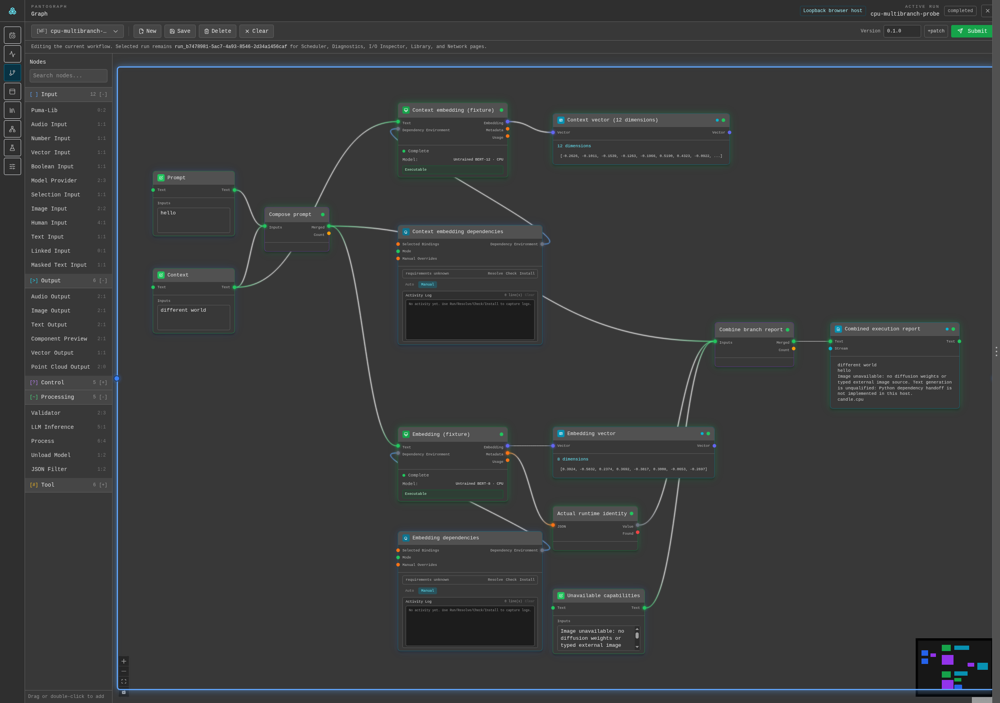

# Pantograph

Build local AI workflows and inspect what actually ran.

Pantograph is a Rust workflow framework with a Svelte workbench and an optional Tauri desktop host. Connect processing and inference nodes, let the scheduler manage execution, and inspect task status, diagnostic events and retained outputs. Applications can also use the [headless workflow service](docs/headless-workflow.md).



*Actual browser workbench with untrained CPU fixtures. [Demo details](docs/images/multibranch-inference-demo-2026-10-12/README.md).*

## Try a workflow without model weights

Use the pinned Rust 1.92.0 toolchain, Node.js 24.12.0, npm 11.6.2 and Python 3. From a checkout:

```bash
git clone https://github.com/MrScripty/Pantograph.git
cd Pantograph
npm install
python3 examples/scheduler-demo/serve.py
```

Open `http://127.0.0.1:8765`. Run the supplied JSON, then try **Missing path** to see a real scheduler rejection.

For the full workbench, run `npm run dev` in another terminal and follow **Open the live workbench**. On **Graph**, load **editor-demo**, edit Text Input, **Save**, then **Submit**. This uses real Rust execution and temporary demo state. [Demo guide](examples/scheduler-demo/README.md).

To reproduce the embedding workflow pictured above, follow the [CPU embedding host guide](examples/cpu-embedding-demo/README.md#multi-branch-cpu-workflow). It uses tiny committed numerical fixtures, with no model download or paid inference.

## Run the desktop app

Install your platform's Tauri prerequisites using the [development guide](docs/development.md), then:

```bash
npm run dev:desktop
```

Use `npm run build:desktop` to package it. The browser demo and native desktop host have different capabilities; the screenshot above does not qualify a native Tauri window. The separate Node Lab authoring surface remains incomplete.

## Develop and integrate

- [Architecture](ARCHITECTURE.md) and [Rust crate map](crates/README.md)
- [Development and checks](docs/development.md)
- [Runtime setup](docs/runtime-operations.md)
- [Headless integration](docs/headless-workflow.md)
- [Research](docs/research/README.md) and [documentation index](docs/README.md)

## License

The repository includes Apache-2.0 license material while Cargo metadata declares `MIT OR Apache-2.0`. Resolve that mismatch before distribution; see [release guidance](docs/release.md).

