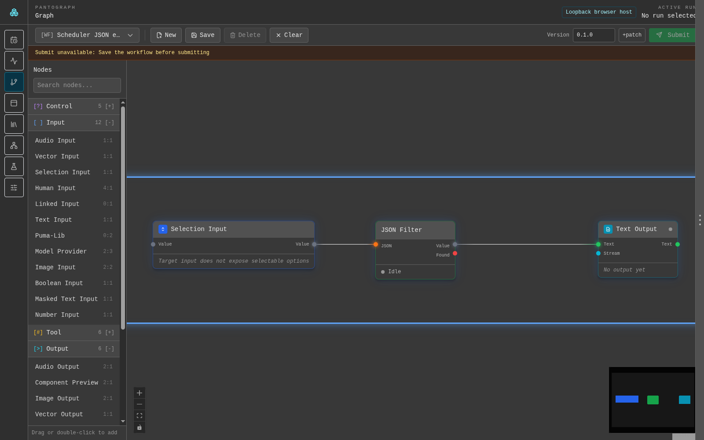
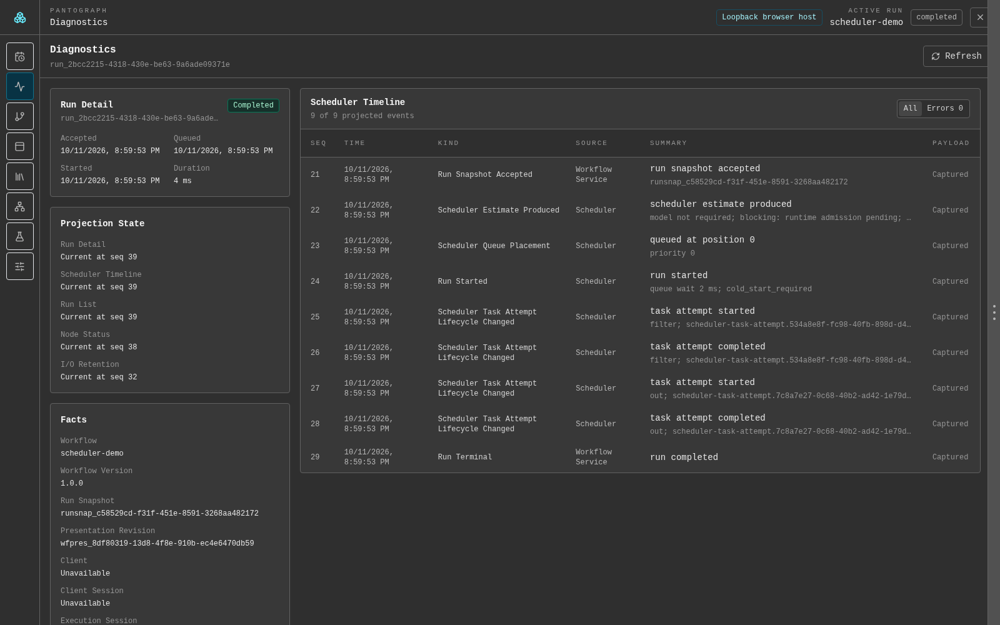
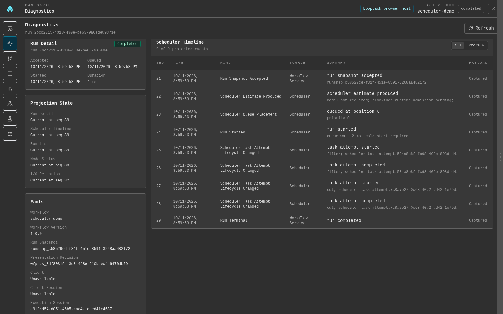
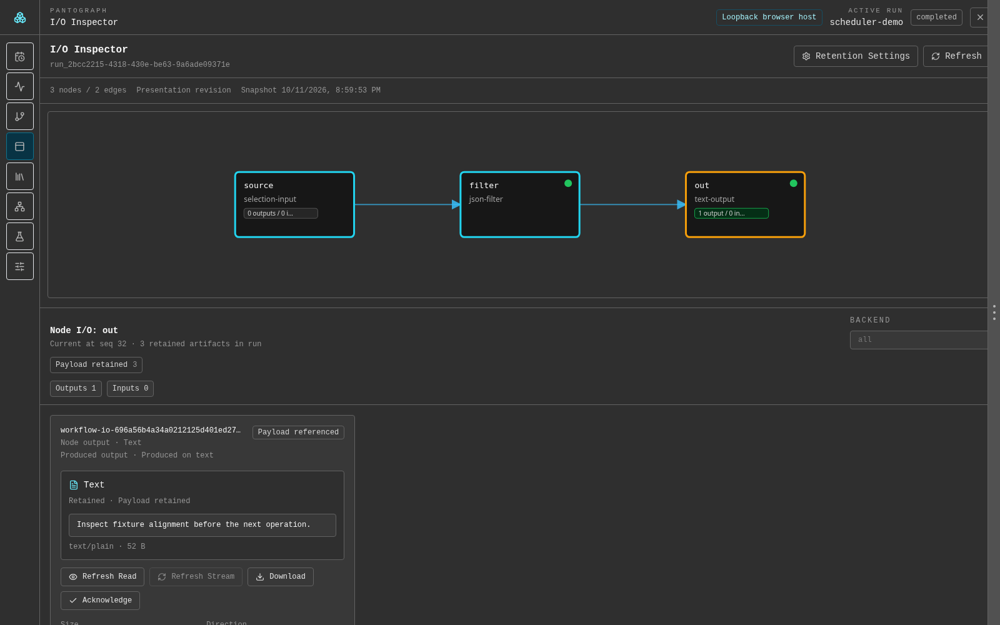
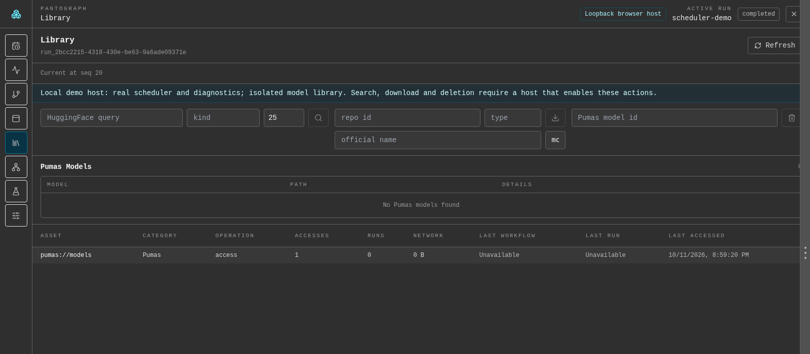
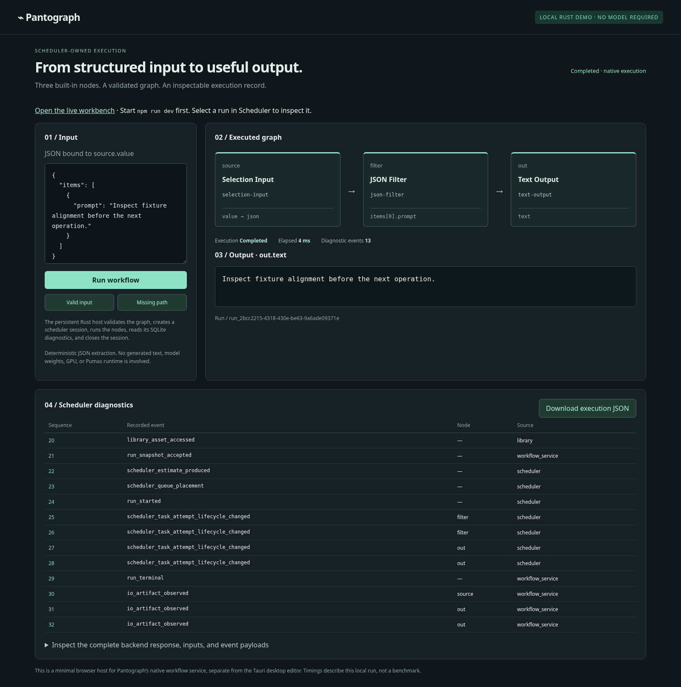

# Pantograph


Pantograph is a local-first, Rust-native framework with an optional desktop app.
It provides unified local inference, node-based workflows, resource-aware
runtime scheduling, real-time observability, and diagnostic tracing for AI
pipelines. Host integrations consume the native Rust interface or projections
through UniFFI, Rustler, and optional HTTP adapters.

## Application gallery

**Review branch:** [PR #71](https://github.com/MrScripty/Pantograph/pull/71).
These assets are tracked on the demo branch pending review and merge.
All captures use the actual Svelte application in Chromium, connected to a
persistent Rust workflow service through an explicit loopback HTTP host. These
are **not native Tauri windows**. The host executes the deterministic graph,
serves live diagnostic queries and retained artifact bytes, and reads an isolated
Pumas library. No service mocks or recorded-response injection are used.

### Workflow graph



The **Graph** page renders backend-produced definitions and the real demo graph.
Editor submission is unavailable here; native execution is demonstrated separately below.

### Execution ledger and diagnostics



The **Diagnostics** page queries real run facts, node status and ledger events
from the running Rust service. [The matching native response](docs/images/scheduler-demo-success.json)
preserves the capture evidence; the application does not replay that file.



The [node-status view](docs/images/execution-node-status.png) reports both executed
tasks completed and all three small payloads retained.

### Workflow-run inspection



The **I/O Inspector** queries the backend run graph and resolved I/O, then reads
the actual retained text through the artifact API. No model inference is claimed.

### Model library



The **Library** page reads a real, isolated empty Pumas catalog and usage ledger.
This limited host disables model search/download/delete with an explanation. No
models were invented or downloaded and no private user library was accessed.

### Scope

The sidebar's **Node Editor** is a separate Node Lab page whose authoring API,
local agent and runtime publishing remain unavailable in current source. It is
not the workflow **Graph** canvas. This change fixes browser transport and
inspection, not node authoring or editor-to-model inference. Native Tauri capture
still requires GTK/WebKit dependencies unavailable in this environment.

## Demonstration and research

A small deterministic workflow now exercises the native scheduler without model
weights: **Selection Input → JSON Filter → Text Output**. It validates a graph,
submits an execution session, extracts text from JSON, and records task lifecycle
and I/O diagnostics in SQLite. Try both successful extraction and a missing path:

```bash
python3 examples/scheduler-demo/serve.py
```

Open `http://127.0.0.1:8765`. See the [demo guide](examples/scheduler-demo/README.md)
for prerequisites, exact scope, raw execution records, and screenshot reproduction.



This is real deterministic Rust execution, not model inference. The minimal
browser host is separate from the desktop editor.

The [GitHub Pages presentation source](docs/presentation/README.md) combines
screenshots, an interactive viewer of recorded scheduler events, inference
ownership boundaries, and readable research editions. It is prepared for local
preview and review; Pages has not been enabled or deployed by this change.

| Area | Research |
| --- | --- |
| Nodes and extensions | [Node Execution and Dynamic Extensions](docs/research/node-execution-and-dynamic-extensions.md) |
| Scheduling | [A Resource Safe Learning Scheduler](docs/research/scheduler/resource-safe-learning-scheduler.md) and [v2 simulation evaluation](docs/research/scheduler/v2-evaluation.md) |
| Inference backends | [Designing Compatible Inference Backends](docs/research/inference-backends/manuscript/designing-compatible-inference-backends.md) |
| Diagnostics and provenance | [Execution Ledger and Provenance](docs/research/execution-ledger-and-provenance.md) |

These are source audits, research proposals, and separately labeled simulations;
they do not establish production or GPU performance. The
[research index](docs/research/README.md) records their pinned editions and limits.

## Architecture

See [ARCHITECTURE.md](ARCHITECTURE.md) for the current module map, target
scheduler-owned task execution model, ownership rules, active transition, and
links to authoritative ADRs and implementation status.

The [current standards audit](docs/audits/2026-09-03-current-standards/README.md)
records the repository-wide compliance baseline and routes its findings into
focused follow-up audits. Its
[remediation portfolio](docs/plans/current-standards-remediation/plan.md)
coordinates the resulting implementation plans.

## Quick Start

1. Clone the repository.
2. Install dependencies:
   ```bash
   npm install
   ```
3. Run the desktop app:
   ```bash
   npm run dev:desktop
   ```

## Installation

### Prerequisites

- Node.js (for `npm`)
- Rust toolchain (`cargo`, `rustc`)
- Tauri system libraries for your OS

Install Rust:

```bash
curl --proto '=https' --tlsv1.2 -sSf https://sh.rustup.rs | sh
source "$HOME/.cargo/env"
```

Install Tauri system dependencies:

```bash
# Debian/Ubuntu
sudo apt install pkg-config libsoup2.4-dev libjavascriptcoregtk-4.0-dev

# Fedora
sudo dnf install pkgconf-pkg-config libsoup-devel javascriptcoregtk4.0-devel

# Arch
sudo pacman -S pkgconf libsoup2 webkit2gtk
```

Install project dependencies:

```bash
npm install
```

## Usage

### Desktop Mode (recommended)

```bash
npm run dev:desktop
```

### Web Preview

```bash
npm run dev
```

The Vite dev server binds to `127.0.0.1` by default. For an intentional LAN
preview, set `PANTOGRAPH_VITE_HOST=0.0.0.0` when starting the server.

### Build Desktop App

```bash
npm run build:desktop
```

### Launcher Script

```bash
./launcher.sh --help
./launcher.sh --test
./launcher.sh --release-smoke
```

### Vision Backend Options

- External OpenAI-compatible server (for example LM Studio)
- Bundled `llama.cpp` sidecar with local model files

## Development

### Prerequisites

- Node.js + npm matching `.node-version` and `package.json`
- Rust toolchain matching `rust-toolchain.toml`
- Python matching `.python-version` for Python-backed smoke paths
- Tauri system dependencies (above)

See [Development](docs/development.md) for toolchain ownership, setup caveats,
and the current verification status.

### Useful Commands

```bash
# Frontend type and configured test checks
npm run typecheck
npm run test:frontend

# Rust workspace checks
cargo fmt --all -- --check
cargo check --workspace --no-default-features
```

These commands prove only their stated scopes. Pantograph does not currently
have one green repository-wide compliance command; see the
[verification audit](docs/audits/2026-09-03-current-standards/04-verification-and-tooling.md).

### Runtime Separation

Python-backed model execution is out-of-process and externally provisioned.
See [Runtime Operations](docs/runtime-operations.md) for interpreter selection,
runtime inspection, recovery, and current security/lifecycle limitations.

### Headless Workflow API

Pantograph exposes a Rust-first service with UniFFI, Rustler, and optional HTTP
projections. See [Headless Workflow Integration](docs/headless-workflow.md) for
the supported ownership model, session flow, exact contract sources, and known
transition boundaries.

## Project Structure

| Path | Description |
| ---- | ----------- |
| `ARCHITECTURE.md` | Current architecture, target execution model, ownership, and status entry points |
| `src/` | Frontend Svelte app, UI components, stores, and services |
| `src-tauri/src/` | Tauri backend commands and runtime wiring |
| `crates/` | Shared Rust crates (`inference`, `node-engine`, `workflow-nodes`, bindings) |
| `packages/svelte-graph/src/` | Reusable graph editor package modules |
| `scripts/` | Validation and tooling scripts |
| `docs/` | Current guides, decisions, audits, and implementation plans |

## Contributing

1. Create a focused branch for one logical change.
2. Follow coding, tooling, accessibility, and documentation standards.
3. Run the smallest checks that decide the affected behavior and contracts.
4. Use Conventional Commits for all commits.

## License

The repository currently contains Apache-2.0 license material while Cargo
metadata declares `MIT OR Apache-2.0`. Resolve that mismatch before
distribution; see [Release](docs/release.md).
