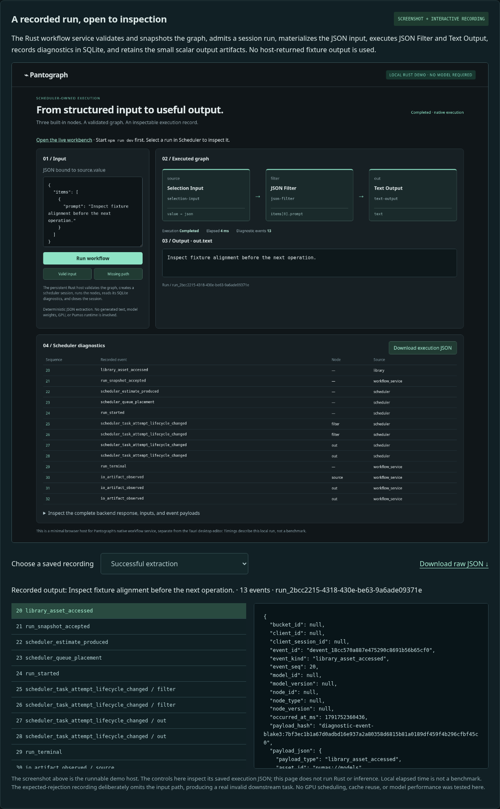
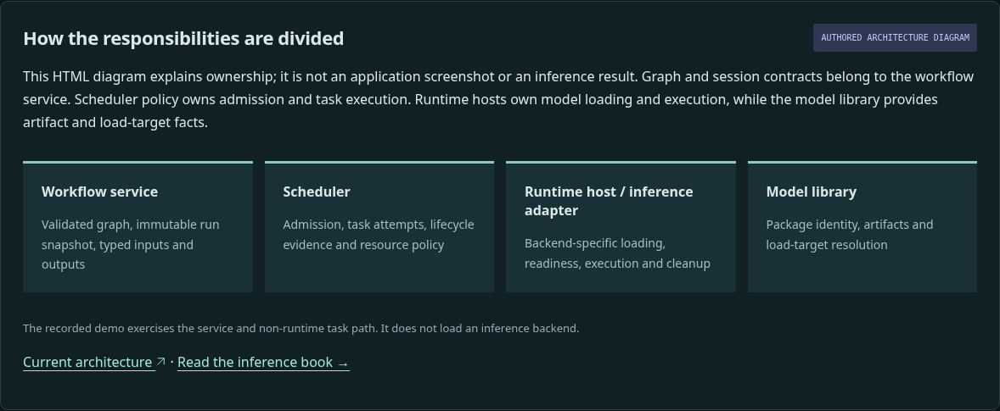
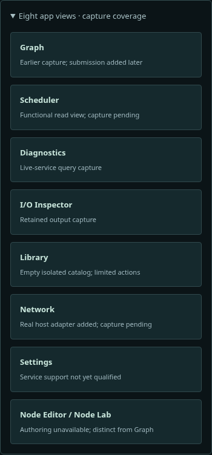

# Presentation appearance review

Source-only clarification, 11 October 2026. These screenshots show the proposed static presentation; the Pages branch is unchanged.

## Recorded run

A real demo-host screenshot plus a browser viewer of saved execution JSON. The controls inspect event payloads; the website does not execute Rust or run inference.

## Architecture diagram

Authored HTML explaining responsibility boundaries. This is not a screenshot of the application or evidence of model inference.

## Capture coverage

Every workbench view has an explicit status. The existing earlier Graph image is distinguished from later source fixes. New Graph/Scheduler/Network captures are pending; Settings and Node Editor authoring remain unqualified.

See the [image audit](../presentation/IMAGE_AUDIT.md) and [build/validation notes](../presentation/README.md). Appearance review and clear approval are required before the next Pages update.
